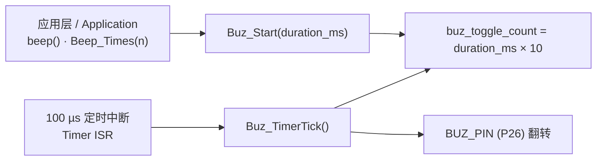
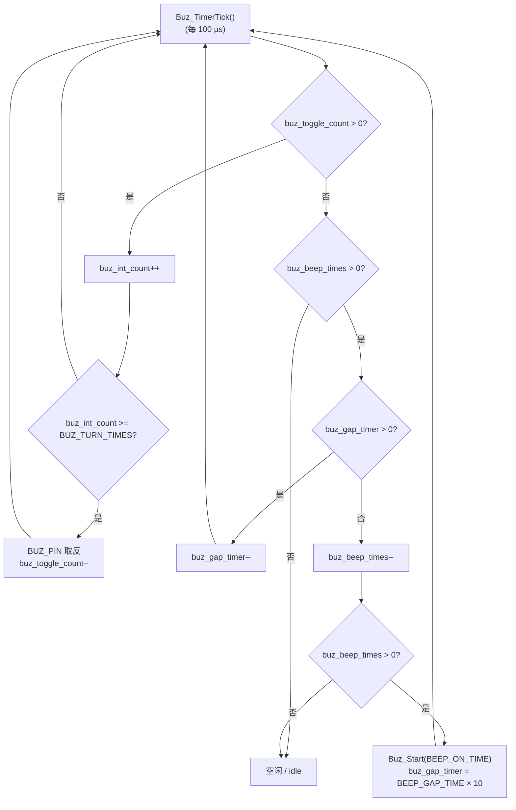

<div align="center">

# Buz

**A timer-ISR-driven buzzer driver for SC / 8051-compatible MCUs.**

**基于定时器中断翻转 IO 驱动的蜂鸣器模块，适用于 SC / 8051 兼容内核单片机。**

[](https://opensource.org/licenses/MIT)
[](https://en.wikipedia.org/wiki/C_(language))
[](https://en.wikipedia.org/wiki/Microcontroller)

[中文](#中文) · [English](#english)

</div>

---

## 目录 / Table of Contents

- [核心特性](#核心特性--key-features)
- [设计说明](#设计说明--design)
- [文件结构](#文件结构--file-structure)
- [配置项](#配置项--configuration)
- [API 参考](#api-参考--api-reference)
- [状态机与时序](#状态机与时序--state-machine--timing)
- [使用示例](#使用示例--usage-example)
- [移植注意事项](#移植注意事项--porting-notes)
- [常见问题](#常见问题--faq)
- [许可与贡献](#许可与贡献--license--contributing)

---

<a id="中文"></a>

## 核心特性 / Key Features

|                     | 中文                                                             | English                                                                                                     |
| ------------------- | ---------------------------------------------------------------- | ----------------------------------------------------------------------------------------------------------- |
| **零硬件外设占用**  | 不用 PWM / 定时器输出通道，仅需 1 个 GPIO + 1 个 100 µs 定时中断 | No PWM peripheral: one GPIO plus one 100 µs timer interrupt is all it needs                                |
| **封装彻底**        | 4 个状态量全部 `static`，对外只有 4 个函数                       | All four state variables are `static`; only four functions are exported                                      |
| **音调可配置**      | `BUZ_TURN_TIMES` 四档：5.0 / 2.5 / 1.25 / 0.83 kHz               | Four selectable pitches via `BUZ_TURN_TIMES`: 5.0 / 2.5 / 1.25 / 0.83 kHz                                 |
| **单声 / 多声**     | `beep()` 响一声，`Beep_Times(n)` 响 n 声并自动插入静音间隔        | `beep()` for one tone, `Beep_Times(n)` for n tones with automatic silence gaps                             |
| **常量时间执行**    | `Buz_TimerTick()` 执行时间与参数无关，可在中断中安全调用         | `Buz_TimerTick()` runs in constant time and is safe to call from an ISR                                     |
| **无动态内存**      | 全静态分配，无 `malloc`，无浮点，无 RTOS 依赖                    | Fully static: no `malloc`, no floating point, no RTOS dependency                                            |
| **C89 兼容**        | 声明位于块首，Keil C51 / SDCC / ARM 均可编译                      | C89-compatible (declarations at the top of a block); builds under Keil C51, SDCC and ARM toolchains         |

---

## 设计说明 / Design

### 为什么用软件翻转而不是 PWM / 定时器输出

无源蜂鸣器需要方波激励才能发声。有源蜂鸣器自带振荡电路，只需给电平；但它在同一台设备上只能发出一个固定音高。

本模块走**无源蜂鸣器 + 定时器中断翻转**的路线：定时中断每 100 µs 调用一次 `Buz_TimerTick()`，内部用软件计数器决定"何时翻转电平"。这样带来两个好处：

1. **音高可变** —— 通过 `BUZ_TURN_TIMES` 改变翻转间隔，即可得到 5.0 / 2.5 / 1.25 / 0.83 kHz。
2. **不占用 PWM 通道** —— 在引脚紧张的老式 SC / 8051 芯片上，把省下来的 PWM 留给呼吸灯、按键灯等更需要的地方。

代价是每 100 µs 多一次中断开销（约 10 000 次/秒），对 8051 兼容内核是可以接受的量级。

A passive buzzer needs a square wave to make any sound at all. This module therefore toggles the pin inside a 100 µs timer ISR and uses software counters to decide *when* to flip. The payoff is a selectable pitch and zero consumption of PWM channels — valuable on SC / 8051-class parts where pins are scarce. The cost is one extra interrupt every 100 µs (~10 000/s), which is acceptable for this class of MCU.

### 状态量 / State variables

| 变量                 | 类型                | 含义                       | 范围            |
| -------------------- | ------------------- | -------------------------- | --------------- |
| `buz_toggle_count`   | `unsigned int`      | 剩余翻转次数               | 0 ～ 65535      |
| `buz_int_count`      | `unsigned char`     | 距下次翻转的中断计数       | 0 ～ 255        |
| `buz_beep_times`     | `unsigned char`     | 剩余响声次数               | 0 ～ 255        |
| `buz_gap_timer`      | `unsigned int`      | 两声之间的间隔计时（tick） | 0 ～ 65535      |

全部为文件级 `static`，模块状态完全自包含，调用方不需要传入上下文，也不存在"忘记清理"的问题。静态占用合计 **6 字节**。

All four variables are file-scope `static`. The module owns its state entirely: the caller passes no context and has nothing to clean up. Total static footprint is **6 bytes**.

### 调用关系 / Call graph



---

## 文件结构 / File Structure

```text
buz/
├── buz.c          # 模块实现 / Module implementation
├── buz.h          # 对外接口 / Public API
├── buz_config.h   # 编译期配置 / Compile-time configuration
├── README.md      # 本文档 / This document
└── LICENSE        # MIT 许可证 / MIT License
```

| 文件 File         | 说明 Description                                                                       |
| ----------------- | -------------------------------------------------------------------------------------- |
| `buz.c`           | 模块实现。状态机、翻转逻辑、蜂鸣序列调度。含 `Buz_Start()` / `Buz_Stop()` 两个 `static` 内部函数 |
| `buz.h`           | 对外头文件。仅声明 `Buz_Init()` / `Buz_TimerTick()` / `beep()` / `Beep_Times()`，无宏污染、无类型泄漏 |
| `buz_config.h`    | 用户配置。引脚定义、时长常量、音调档位；`buz_config.h` 需先于 `buz.h` 被包含          |

> **注意**：源文件当前以 **GBK** 编码保存（Keil C51 工具链习惯），中文注释可正常显示；本 README 为 UTF-8。若后续要在 GitHub 上浏览 `.c` 内的中文注释，建议统一转成 UTF-8（Keil 需在 `Options → Encoding` 中选择 UTF-8）。
>
> **Note**: the C sources are currently saved in **GBK** (a Keil C51 habit) and their Chinese comments render fine there; this README is UTF-8. If you want the Chinese comments to show up correctly on GitHub, consider converting the sources to UTF-8 and switching Keil to `Options → Encoding → UTF-8`.

---

## 配置项 / Configuration

全部配置集中在 `buz_config.h`，使用者通常只需改这一个文件。

All configuration lives in `buz_config.h`; in practice this is the only file you need to touch.

```c
/* 蜂鸣器引脚 / Buzzer pin */
#define BUZ_PIN          P26

/* 单次响声持续时间 (ms) / Duration of one tone */
#define BEEP_ON_TIME     200

/* 声与声之间的静默间隔 (ms) / Silence between two tones */
#define BEEP_GAP_TIME    200

/* 翻转间隔档位，决定音高 / Toggle-interval step, decides the pitch */
#define BUZ_TURN_TIMES   1
```

### 音调档位 / Pitch table

翻转间隔 = `(BUZ_TURN_TIMES + 1) × 100 µs`，方波频率 = `1 / (2 × 翻转间隔)`。

| `BUZ_TURN_TIMES` | 翻转间隔 (µs) | 周期 (µs) | 频率 (Hz) | 约等于 |
| ----------------- | ------------- | --------- | --------- | ------ |
| 0                 | 100           | 200       | 5000      | 5.0 kHz |
| **1**（默认）     | 200           | 400       | 2500      | 2.5 kHz |
| 2                 | 400           | 800       | 1250      | 1.25 kHz|
| 3                 | 600           | 1200      | 833       | 0.83 kHz|

---

## API 参考 / API Reference

```c
void Buz_Init(void);
void Buz_TimerTick(void);
void beep(void);
void Beep_Times(unsigned char times);
```

### `Buz_Init(void)` — 蜂鸣器初始化 / Initialization

把 `P26` 配置为推挽输出并置高（关闭蜂鸣器）。

Configures `P26` as a push-pull output and drives it high (buzzer off).

```c
void Buz_Init(void)
{
    P2CON |= (1 << 6);   /* 设为输出 / set as output      */
    P2PH &= ~(1 << 6);   /* 推挽模式 / push-pull mode     */
    BUZ_PIN = 1;         /* 默认关闭 / default off        */
}
```

- **调用时机**：上电后、开启定时中断前调用一次。
- **幂等性**：重复调用安全，会把蜂鸣器强制关闭（但不清空 `buz_beep_times`，如需彻底复位请调用 `Buz_Stop()`）。
- **Call once after power-up and before enabling the timer interrupt. Re-entrant-safe; it forces the pin off (note that it does not clear `buz_beep_times`).**

### `Buz_TimerTick(void)` — 定时中断服务例程 / Timer ISR handler

**必须**在 100 µs 周期的定时器中断中调用。它是整个模块的"心跳"。

Must be called from a timer interrupt with a **100 µs** period. It is the heartbeat of the module.

```c
void Buz_TimerTick(void)
{
    if (buz_toggle_count > 0) {              /* ① 正在发声：计数并翻转 */
        buz_int_count++;
        if (buz_int_count >= BUZ_TURN_TIMES) {
            BUZ_PIN       = !BUZ_PIN;
            buz_int_count = 0;
            buz_toggle_count--;
        }
    } else if (buz_beep_times > 0) {          /* ② 静音间隔：等待下一声 */
        if (buz_gap_timer > 0) {
            buz_gap_timer--;
        } else {
            buz_beep_times--;
            if (buz_beep_times > 0) {
                Buz_Start(BEEP_ON_TIME);
                buz_gap_timer = BEEP_GAP_TIME * 10;   /* ms → 100 µs tick */
            }
        }
    }
}
```

- **执行时间恒定**：最坏路径为一次比较 + 一次自减，可安全用于中断上下文。
- **不可重入**：状态量非 `volatile`（见[移植注意事项](#移植注意事项--porting-notes)）。
- **Constant execution time, safe in an ISR. Not re-entrant — the state variables are not `volatile` (see porting notes).**

### `beep(void)` — 单声提示 / Single beep

发出一次固定时长的蜂鸣，常用于按键确认、操作成功等提示音。

Emits one fixed-duration tone; typically used for key-press or operation confirmation.

```c
void beep(void)
{
    Buz_Start(BEEP_ON_TIME);
}
```

### `Beep_Times(unsigned char times)` — 多声提示 / Multiple beeps

发出 *n* 声蜂鸣，声与声之间静默 `BEEP_GAP_TIME`。

Emits *n* tones separated by a silence gap of `BEEP_GAP_TIME`.

```c
void Beep_Times(unsigned char times)
{
    if (times == 0) return;
    buz_beep_times = times;
    Buz_Start(BEEP_ON_TIME);
    buz_gap_timer = BEEP_GAP_TIME * 10;
}
```

```c
Beep_Times(2);   /* 响两声 / two tones  */
Beep_Times(3);   /* 响三声 / three tones */
```

- `times == 0` 直接返回，不产生任何输出。
- 再次调用会**重置**当前序列，不排队。
- `times == 0` returns immediately without any output. A new call **resets** the running sequence; calls are not queued.

---

## 状态机与时序 / State Machine & Timing



### 单声时序 / Single-tone timing

以默认配置（`BEEP_ON_TIME = 200 ms`、`BEEP_GAP_TIME = 200 ms`、`BUZ_TURN_TIMES = 1`）为例：

| 阶段 Stage            | 计数设置 Counter                                        | 实际时长 Actual     |
| --------------------- | ------------------------------------------------------- | ------------------- |
| 相邻两次翻转          | `buz_int_count` 累加到 `BUZ_TURN_TIMES`                | `(1 + 1) × 100 µs = 200 µs` |
| 一声完整发声          | `buz_toggle_count = 200 × 10 = 2000` 次翻转            | `2000 × 200 µs = 400 ms`     |
| 两声之间静默          | `buz_gap_timer = 200 × 10 = 2000` tick                  | `2000 × 100 µs = 200 ms`     |

### 多声总时长 / Total duration of a multi-tone sequence

`Beep_Times(n)` 的实际总时长为：

```
T_total = n × (发声时长) + n × (间隔时长)
        = n × 400 ms + n × 200 ms
        = n × 600 ms          （默认配置）
```

> **注意**：间隔计时器在**发声阶段不递减**（它只在 `buz_toggle_count == 0` 的静默分支里递减），所以每一声之后都完整地插入了一个 `BEEP_GAP_TIME` 间隔；最后一声播完后还会多出一个间隔才彻底静默。
>
> **Note**: the gap timer is **not** decremented while a tone is playing — it only counts down in the idle branch. Consequently every tone is followed by a full `BEEP_GAP_TIME` gap, and one extra gap elapses after the last tone before the module goes fully silent.

### 已知偏差 / Known deviations

模块里有两处**命名与实际行为不一致**的地方，使用时需要留意：

There are two places where the **naming does not match the actual behaviour**:

**1. 发声时长是设定值的 2 倍 —— `BEEP_ON_TIME` 不是实际毫秒数**

`Buz_Start()` 按 `buz_toggle_count = duration_ms × 10` 计数，这隐含"一次翻转 = 100 µs"。但真实翻转间隔是 `(BUZ_TURN_TIMES + 1) × 100 µs`，默认档为 200 µs，于是：

```
实际发声时长 = duration_ms × 10 × (BUZ_TURN_TIMES + 1) × 100 µs
             = duration_ms × (BUZ_TURN_TIMES + 1) ms
默认配置下  = 200 ms × 2 = 400 ms      （而非 200 ms）
```

若要严格得到 `BEEP_ON_TIME` 毫秒，应把计数改为按翻转档位折算：

```c
static void Buz_Start(unsigned int duration_ms)
{
    /* 每 (BUZ_TURN_TIMES + 1) 次 tick 才翻转一次，折算成翻转次数 */
    buz_toggle_count = (duration_ms * 10) / (BUZ_TURN_TIMES + 1);
    buz_int_count    = 0;
}
```

**2. `duration_ms` 存在 16 位溢出风险**

`buz_toggle_count` 是 `unsigned int`（16 位，上限 65535），而 `duration_ms × 10` 在 `duration_ms > 6553` 时会回绕。模块本身只用于几百毫秒的提示音，实际不会触发；但若要支持长音，需改成 32 位计数或分段播放。

`buz_toggle_count` is a 16-bit `unsigned int` (max 65535) and `duration_ms × 10` wraps when `duration_ms > 6553`. For the short tones this module is built for this never happens, but long tones would need a 32-bit counter or segmented playback.

---

## 使用示例 / Usage Example

```c
#include "H/Function_Init.H"
#include "buz.h"

void main(void)
{
    System_Init();
    Buz_Init();            /* 初始化 / initialization        */

    beep();                /* 单声确认 / one confirmation tone */
    Beep_Times(3);         /* 三声错误提示 / three error tones */

    while (1) { }
}

/* 100 µs 定时中断 / 100 us timer interrupt */
void Timer0_ISR(void) interrupt 1
{
    Buz_TimerTick();       /* 每 100 µs 调用一次 / call every 100 us */
}
```

> **规范提示**：宿主 C 中 `main` 应返回 `int`（`int main(void)`）。多数嵌入式工具链接受 `void main(void)`，但可移植写法是前者。
>
> **Style note**: in hosted C, `main` should return `int`. Most embedded toolchains accept `void main(void)`, but `int main(void)` is the portable form.

---

## 移植注意事项 / Porting Notes

- **中断周期必须准确。** 模块所有时长都以 **100 µs** tick 为单位。若你的定时中断不是 100 µs，请按比例缩放 `BEEP_ON_TIME` / `BEEP_GAP_TIME`（`新值 = 旧值 × 新 tick / 100 µs`），否则音高与时长都会偏差。音高由 `BUZ_TURN_TIMES` 与实际 tick 共同决定：`f = 1 / (2 × (BUZ_TURN_TIMES + 1) × tick)`。
- **中断上下文与可见性。** 状态量是普通 `static` 而非 `volatile`。当 `Buz_TimerTick()` 只在一个中断中调用、而 `beep()` / `Beep_Times()` 在主循环或任务中调用时，编译器**有可能缓存**这些值导致行为异常。稳妥做法是把跨上下文共享的变量声明为 `volatile`，或把 `beep()` / `Beep_Times()` 的调用也收敛到中断/任务上下文中。
- **不可重入 / 单实例。** 状态是模块级全局变量，一个模块实例只能驱动一路蜂鸣器。需要 N 路时可用宏改名多次编译（`-Dbeep=BUZ2_beep`），或把文件级静态状态改为调用方传入的上下文结构体。
- **有源蜂鸣器。** 本模块针对**无源**蜂鸣器。若硬件是有源蜂鸣器（自带振荡），只需给电平，`BUZ_TURN_TIMES` 将失去意义。
- **引脚电平极性。** `BUZ_PIN = 1` 表示关闭（低电平有效）。若你的硬件是高电平有效，把 `Buz_Init()` 与 `Buz_Stop()` 中的赋值取反即可。
- **`Buz_Stop()` 目前未被调用。** 它是 `static` 内部函数，保留作为内部预留；如需对外提供"立即静音"能力，把它加进 `buz.h` 并去掉 `static` 即可。
- **`beep()` 与多声序列的关系。** 在 `Beep_Times(n)` 播放过程中调用 `beep()`，会**重置当前声**并把剩余的 `buz_beep_times` 保留下来，序列会继续播完；它不是"取消"。要真正取消，需要先调用 `Buz_Stop()` 并清零 `buz_beep_times`。

---

## 常见问题 / FAQ

**Q：声音比预期长一倍。**
见[已知偏差](#已知偏差--known-deviations)第 1 条。默认配置下 `BEEP_ON_TIME = 200` 实际响约 400 ms。

**Q：音调不对 / 频率偏高偏低。**
确认中断周期确实是 100 µs。频率 = `1 / (2 × (BUZ_TURN_TIMES + 1) × 实际 tick)`。

**Q：多声之间没有间隔，声音连成一片。**
检查 `buz_gap_timer` 是否被其他代码覆盖，以及是否在播放期间调用了 `beep()`。

**Q：最后一响之后还有一段"多余"的静默。**
这是当前状态机的固有行为（见[多声总时长](#多声总时长--total-duration-of-a-multi-tone-sequence)）。

**Q：能否在播放中打断？**
`Buz_Stop()` 可以立即静音，但它当前是 `static`；暴露到 `buz.h` 后还需一并清零 `buz_beep_times`，否则剩余序列会继续。

**Q：单次最长能响多久？**
受 `buz_toggle_count` 16 位上限约束。默认翻转周期（200 µs）下约 13 秒，但 `Buz_Start()` 的 `duration_ms × 10` 换算在 `duration_ms > 6553` 时会溢出，实际安全范围应远小于此。

**Q：可以驱动有源蜂鸣器吗？**
可以，但只需置电平，频率设置无效；`beep()` 里的时长控制对有源蜂鸣器依然有效（电平维持时长）。

---

## 许可与贡献 / License & contributing

MIT —— 详见 [LICENSE](LICENSE)。

Issues and pull requests are welcome. Please keep the module free of hardware dependencies so it stays portable across projects.

欢迎提交 Issue 与 Pull Request。请保持模块不引入额外的硬件依赖，以确保它在各项目间可移植。

---

<a id="english"></a>

## English Summary

`Buz` drives a **passive buzzer** by toggling a single GPIO inside a 100 µs timer ISR. It needs no PWM peripheral, exposes only four functions, and keeps all of its state in file-scope `static` variables (6 bytes total).

- **`Buz_Init(void)`** — configure the pin as push-pull output, buzzer off.
- **`Buz_TimerTick(void)`** — call from a 100 µs timer ISR; drives the state machine.
- **`beep(void)`** — one tone of `BEEP_ON_TIME`.
- **`Beep_Times(unsigned char times)`** — *n* tones separated by `BEEP_GAP_TIME` of silence.

Pitch is selected by `BUZ_TURN_TIMES` (5.0 / 2.5 / 1.25 / 0.83 kHz). See [Known deviations](#已知偏差--known-deviations) for the two places where the current implementation does not match its own naming — the tone is roughly **twice** as long as `BEEP_ON_TIME` suggests, and `duration_ms × 10` can overflow the 16-bit counter above 6553 ms.
